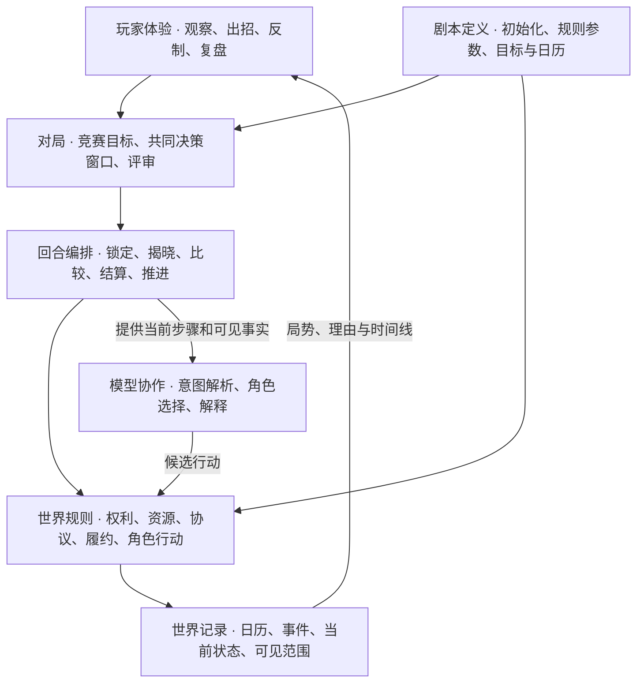

# Career Rivals 设计架构

Career Rivals 的核心循环是**看局势、选行动、观察对手和世界如何回应、据此改下一步**。一场对局是一个独立演化的世界实例。剧本定义世界开局和这场竞争的目标，对局组织决策机会，世界规则决定行动何时产生效力，模型负责理解意图和扮演角色。

## 1. 玩家体验与对局目标

**一场对局要让双方争同一个结果，各自拥有不同的手段。** 玩家看到哪些局势值得介入、对手已经承诺了什么、哪些资源还有争夺空间。主要行动可以推进自己的计划，也可以抢占对手需要的资源、争取对手考虑中的合作方，或利用期限压力提出交换。

体验层需要向玩家提供三种信息：**决策前**看得到当前权利、已知约束和期限；**结算后**看得到哪些行动改变了局势、为什么；**下次决策时**看得到还能申请、协商或调整什么。终局把评审胜负和双方实际改变的世界都呈现出来。

[玩法与主动对抗设计](./GAME-DESIGN.md)

## 2. 剧本定义与对局实例

| 对象 | 定义或维护的内容 |
| --- | --- |
| 游戏通用规则 | 形成有效承诺的条件、争用处理方式、同步决策和公平性约束、事实的形成与公开 |
| 剧本定义 | 竞争目标、职业与权限、初始人物与资源、日历、已注册规则和参数、终局评审 |
| 对局实例 | 这一局正在发生的事，包括当前时间、持有的权利、尚未确认的报价、人物计划、历史与待到期事项 |

剧本是一份可复用的开局定义。开局时创建独立的对局实例，并绑定剧本版本。后续玩家签约、NPC 改变目标、资源易手，都发生在该实例中。开新局可以使用同一剧本从头开始，存续中的对局按开局的规则版本继续。

剧本通过组合原语表达题材。「货运入口」和「黄金档」都可以定义为有使用条件的独占时段。「门店交付」和「样片交付」都可以定义为带期限和完成条件的承诺。剧本可以调整这些对象的参数和裁定条件。需要密封竞价之类的新玩法时，才增加可供多个剧本使用的新原语。

## 3. 对局编排与回合生命周期

对局编排掌管**什么时候可以选择，什么时候处理结果**。回合是玩家的决策窗口，世界可以在两个窗口之间经历多个计费、履约或 NPC 行动时点。

1. **开窗。** 生成共同的公开局势和起始事实版本。玩家可查事实、形成自己的草稿、核对成本和承诺。
2. **锁定与揭晓。** 各自确认主行动，双方锁定后一起公开。提议可以包含相互依赖的条款，后续按协议所需的确认处理。
3. **推演与裁定。** 从共同起点校验行动，把争用同一时段、商户或其他有限能力的行动放在同一步比较。有效权利继续约束行动。角色对同批送达的竞争报价作选择。
4. **提交与释出结果。** 写入已成立的变化，公布可见的原因和条件。还价、待确认交换或待核实事项保留为相应状态。
5. **推进世界。** 按游戏时间处理到期与主动事件。到达下一决策窗口时形成新起点，到达终局时按剧本评审。

编排要为主动对抗保留响应机会。如果新的争用会影响对手的关键承诺，剧本和裁定必须保证对手在相关期限前看到结果，并有一次有效决策窗口。时间推进和 NPC 主动行动同样遵守这些约束。

## 4. 世界规则的职责划分

| 领域 | 维护的状态 | 负责回答的问题 |
| --- | --- | --- |
| 人物和职业 | 身份、权限、角色目标、计划与履约经历 | 谁能发起、确认或调整这件事？人物有哪些可采取的行动？ |
| 资源与经济 | 现金、额度、资源容量、占用和有效使用权 | 还能承担多少费用？同一个时段或同一份产能能否同时承诺？ |
| 谈判、协议和履约 | 报价版本、各方确认、有效条件、义务和完成记录 | 哪些条款已经成立？什么时候生效、到期或违约？ |
| 争用与裁定 | 比较范围、裁定方式、分配理由与可调整条件 | 两份单独可行的行动碰到一起时，如何分配或退回协商？ |
| 世界时间与触发 | 游戏日历、待发生事项和触发原因 | 推进到哪个时点？哪些合同、经营事项或人物计划现在要处理？ |
| 评审 | 评审时点、剧本标准与每项得分的证据 | 谁赢了？哪几项已发生的结果支持这个分数？ |

同一条业务链可以经过多个领域。例如一份「出资换时段」的报价，由协议规则判断各方是否同意，由资源规则检查时段能否转移，由经济规则检查费用能否承担。任何必要条件未满足，报价仍处于对应的待处理状态。全部条件满足后，按条款一起登记权利和费用。

## 5. 事实、角色知识与模型上下文

对局同时维护**发生了什么、现在是什么状态、谁知道什么**。事件记录行动和原因。当前状态反映仍有效的权利、余额和承诺。可见视图决定玩家和角色能读到哪些事件与状态。由此可以按回合复盘玩家当时知道什么，也能让 NPC 根据自己的经历行动。

| 信息 | 例子 | 如何进入后续决策 |
| --- | --- | --- |
| 对局事实 | 已批准的排班、已生效的协议、发生过的经营结果 | 按有效期与状态参与规则校验 |
| 有来源的陈述 | 商户报价、玩家提交的计划、角色表达的意愿 | 表示谁在什么时点表达了什么，按其类型参与谈判 |
| 角色内部状态 | 眼下的计划、优先事项与经历 | 按角色可见范围进入该角色上下文 |
| 尚待验证的信息 | 预计成本、暂未得到的授权、模型发现的潜在冲突 | 提示询价、查证或追问，验证后按规则形成对应事实 |

**模型在三个环节参与。** 输入时，把玩家的话解析成可确认的行动。推演时，按角色的可见事实、当前目标、履约经历和同批报价选择答复或提出行动。解释时，把已裁定的结果组织成玩家能读懂的反馈与复盘。模型调用按任务和事实版本组装上下文。人物改变计划后，下一次调用直接读新状态。权利、金额和计分以世界规则提交的结果为准。

[时间、事实和上下文的详细设计](./TECHNICAL-DESIGN.md)

[程序模块与 Agent 运行方式](./TECHNICAL-DESIGN.md#7-程序模块与-agent-运行方式)

## 6. 用一条对抗链验证各层

以两个题材共用的「抢关键时段」为例。

1. **剧本**定义可独占的时间资源、授权者、使用条件、评审期限。它可以指向货运入口，也可以指向播出档期。
2. **玩家**看到对手已经有交付承诺，主动为自己的项目申请对方可能需要的时段，并承担对应义务。
3. **回合编排**固定双方申请，以同一份起始状态把重叠申请送到争用裁定。
4. **世界规则与角色**检查既有排班和替代方案。若条款变更还需要多方授权，记录为待确认的排班提议。
5. **世界记录**公布已成立的占用或待确认条件及依据，保留双方行动和裁定之间的因果关系。
6. **下一窗口**让受影响的一方改期、换资源或出价交换。NPC 的下一次推演也读取这次公开变化。终局可以指出这一手如何影响了履约和得分。

架构验收分两步。先确认玩家能从公开局势主动出招，而对手有实际可走的接法。再确认换成另一个题材时，同一条争用链只需更换剧本定义，就能从行动锁定走到评审。
