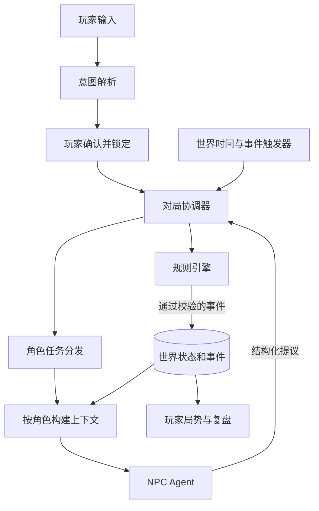

# Career Rivals 通用世界引擎技术设计

## 1. 引擎与剧本的边界

**规则引擎负责维护世界，剧本负责定义这一局的世界，模型负责理解玩家意图和推演角色选择。** 上层职责划分见 [设计架构](./ARCHITECTURE.md)。首版建议采用模块化单体和一个事务数据库，API 与 Worker 分进程运行。每局绑定剧本、规则和模型配置的版本，历史对局按其记录的版本查询和重放。

| 层 | 负责什么 | 典型内容 |
| --- | --- | --- |
| 通用引擎 | 执行跨题材共用的规则，检查每次状态变更 | 货币与额度、资源与时段、授权、报价、协议、履约、定时任务、争用、评审 |
| 剧本包 | 用声明式数据组合规则，定义起点和目标 | 职业能力、初始资产、场地或档期、NPC 动机、决策窗口、评审条件 |
| 模型 | 把自然语言转成候选行动，为 NPC 选择行动、生成解释 | 条件报价、接受或还价、角色新计划、带来源的回顾 |

剧本包包含实体定义、日历与决策窗口、初始状态、角色设定、触发器和评审规则。触发器采用「事件或时间 → 条件 → 动作」结构，例如「合作方错过一次交付 → NPC 当前有空闲产能 → 安排一次重新询价」。条件由类型化表达式组合，例如比较余额、查询有效承诺、统计履约事件。动作由引擎注册，例如提交报价、登记预约申请、安排未来检查。发布前校验引用、单位、时间范围和权限，限制触发深度与单次推进内的执行次数。

换题材时，编剧可以新增资源、角色、事件描述和已有原语的组合。引擎遇到剧本包引用未注册的原语时，在发布阶段指出缺少的能力。只有出现现有原语无法表达的通用机制，例如密封竞价与保证金结算，才扩展引擎。扩展应提供独立的规则、数据约束和测试，供多个剧本启用。

| 通用能力 | 旧车站经营权 | 制作人争黄金档 |
| --- | --- | --- |
| 独占资源与时段 | 东侧货运入口 | 黄金档播出时段、录音棚 |
| 条件报价和确认 | 分摊接电费换卸货安排 | 承担制作费换优先排播 |
| 承诺和履约 | 交付门店、按月经营 | 交付样片、按期完成制作 |
| 决策与评审 | 年度窗口，按许可与经营实绩评审 | 周度窗口，按档期适配与交付实绩评审 |

第二个剧本的技术验收是只提交剧本数据，就能跑通两人争用档期、NPC 还价、跨窗口履约和终局评审。

## 2. 时间模型

维护三种顺序，各有独立字段。

| 顺序 | 表示什么 | 谁推进 |
| --- | --- | --- |
| 现实时间 | 锁定截止、请求超时、结算任务租约 | 服务端时钟 |
| 世界时间 | 决策窗口、时段占用、合同生效、经营扣款 | 剧本日历和结算器 |
| 事件序号 | 房间内事实提交的先后，以及每次读取所依据的版本 | 数据库事务 |

回合是玩家可以下决定的窗口。世界时间在窗口内固定，双方基于同一个公开版本行动。窗口之间，结算器按游戏时点推进到下一窗口，逐个处理到达的任务，例如月度收支、合同到期、资源释放和 NPC 检查。相同日期可以有多个游戏时点，顺序由剧本公开规则定义。每个时点先处理履约和已生效的变更，再对到期承诺作判断，避免当天完成交付却先被判失约。时段采用左闭右开区间，相邻预约可以衔接。

时间推进器查询待执行任务的最近时点，处理完再查下一项。临时生成的任务也进入同一队列，支持按事件和按日期触发。已执行任务保存稳定标识，周期任务为每次到期记录独立执行键。只有已生效的经营周期才生成扣款任务。时间推进遇到需要真人确认的交换时，可将报价留到下一可操作窗口，或按既定有效期失效。影响对手关键承诺的可争夺资源需要在剧本中留出反制窗口。发布时检查显式安排，运行时若某项新的争用分配会让对手来不及响应，则本次分配保留为待确认提议，按已公开的分配规则处理。

例如，某剧本可以每年开一个决策窗口，同时在两轮之间按月记录六笔试营业收支。月末入账会影响后续月份的可用资金。如果第七个月无法覆盖支出，按合同进入预设的欠款、暂停或其他处置流程，形成可查的事实。换成按周决策的剧本时，沿用同一套队列和到期判断。

## 3. 事实、状态与历史

每局以初始状态和追加式事件记录为历史来源。结算事务同步更新当前状态表，供界面和规则快速查询。每轮开始保存可重建的快照和事件序号。历史查询以指定序号为上限，快照后的事件继续按序应用。

| 记录 | 最小字段或形式 |
| --- | --- |
| 世界事件 | 房间内序号、世界时点、事件类型、主体、结构化变化、来源或原因事件、可见性、规则版本、幂等键 |
| 当前状态 | 实体、资源、余额、权利、合同、NPC 当前计划、调度任务，以及各记录的来源事件 |
| 报价与合同 | 报价及条款版本、参与方、确认记录、有效期、生效条件、状态和履约义务 |
| 调度任务 | 到期时点、执行键、触发来源、预期状态和执行结果 |

**事实的身份取决于发生了什么。** 「有人提交了三万元报价」可以是公开事实，报价中的预计成本仍是估计。「赵工核准周六卸货」才形成时段占用。「老周考虑换场」在角色层可以是内部计划，只有他的对外表态或行动进入公开视图。询价得到的新价格带报价方和有效期，后来更新报价时，新旧两个版本都可追溯。

合同生命周期为「报价 → 各方确认 → 待生效或生效 → 履约、到期或终止」。条款修改后按新版本重新取得所需确认。承诺条件引用明确的实体和状态，例如「西院周六卸货权已核准」。条件满足时，在一个事务里重验权限和余额，再写入相关权利与付款。分阶段履约的合同按约定分别入账。失约、改期及纠错都用新事件记录，修正后的状态可追溯到原记录。在复盘中按当时已经公开的事件解释当时的选择。

## 4. 模型上下文如何随世界变化

每次调用都根据任务和指定的事实版本重建上下文。上下文由服务端组装，分为三类。

| 任务 | 读取内容 | 产出 |
| --- | --- | --- |
| 解析玩家行动 | 本人草稿、当前公开状态、可用行动、相关实体和条款 | 候选行动、待核实字段、需玩家确认的投入 |
| 推演 NPC | 角色能知道的事实、该角色的稳定设定、当前目标和计划、相关履约经历、同一批次内对该角色已公开或送达的全部报价 | 接受、拒绝、还价或自主行动提议，以及所引用的事实 |
| 生成回顾 | 对应玩家可见的历史事件、实际结算依据和计分明细 | 有来源的解释和双人时间线 |

角色的长期动机、计划和关系保存在角色状态里，变化从已经确认的角色事件派生。老周的搬迁经历可以一直保留为有出处的经历。拿到固定门店之后，系统以新事件更新他的计划和优先事项，下一次调用直接读取更新后的版本，同时按需加载原来的经历。摘要用于压缩历史，带事件范围和来源，可随事实版本重新生成。活跃合同、截止日期、有效时段和当前金额直接读取结构化状态。相关主体、最近事件及其因果关联用于决定再补哪些旧事实。

结构化模型输出包含提议类型、主体、条款、依据事件和所用版本。服务端校验引用是否存在、角色是否知道、该提议是否有权限执行，以及相关权利和余额是否仍有效。证据缺失时，模型可以建议询价、追问或等待。涉及玩家出资和权利调整时，沿用正式确认流程。上下文按角色和任务限制可见范围，正式结算和对手查询均从对应视图取数，报价或草稿里的文字按内容处理。

同一 NPC 同时收到两份竞争报价时，在同一次判断中看两份报价，使用稳定的展示顺序，并检验其产能能否同时承诺。记录输入版本、引用事件、提示与模型版本，以及采用的结构化输出，支持复盘和故障恢复。

## 5. 一轮怎样结算

1. **冻结共同起点。** 回合开始记录起始快照。双方确认结构化行动后锁定，提交先后只影响现实等待时间。双方锁定后，正式行动一起公开。
2. **批量识别冲突。** 用共同起点验证两份行动，按实际争用的资源、时段和 NPC 分组。优先履行已经有效的权利。同一资源的候选同时参与比较，所有抽签结果和依据写进事件。需要另一方确认的内容保留为报价。
3. **推演并校验候选结果。** 在工作副本上依次应用有依赖的规则步骤。互相竞争的候选在同一步比较。到达触发时点的 NPC 根据该步可见事实提出行动，并走相同的权限和履约校验。
4. **原子提交。** 模型调用在数据库事务外执行。提交时检查回合、起始版本和唯一结算键，在同一事务写入回合结果、事件、状态以及未来任务。并发提交以唯一键和版本条件裁定，已成功的重试直接返回已存结果。新增确认在允许的窗口生效，或者排入下一窗口。
5. **推进并打开下一窗口。** 用可恢复的任务逐个物化中间时点的结果。每次执行以任务键去重，持久化执行进度。结算与时间推进完成后再发布下一轮的完整公开状态。终局计分读取评审时点的状态和事件，并保留每项分数的来源。

模型超时时，复用已持久化且仍匹配当前上下文的候选响应，或进入预先配置的角色规则或人工接手流程。回放直接读取已提交事件，包括采用的角色行为和抽签结果。要比较另一种出招，另建分支从相同快照开始模拟。

## 6. 首版实现与验收

1. **先做可重放的规则核心。** 实现回合、世界时点、事件账本、预约、协议、履约与通用计分条件，用预设 NPC 响应走通双人结算。
2. **再接入模型。** 接入意图解析和 NPC 选择，支持按角色构建上下文、验证结构化输出和保存采用结果。经营、档期和计分仍由规则服务执行。
3. **用第二个题材检验可配置性。** 用同一套引擎加载旧车站和黄金档两个最小剧本包，跑通同一组核心用例，再决定是否补充可复用的规则原语。

| 验收用例 | 通过条件 |
| --- | --- |
| 变更锁定顺序 | 固定回合起点、行动、模型响应和抽签种子后，交换提交顺序得到相同的合法候选与分配结果 |
| 回合之间跨过多个账期 | 仅执行实际生效的账期，每笔记录只入账一次，恢复后可继续推进 |
| 角色改变计划 | 下一次调用看到新计划，旧回合仍能按当时的事实和可见范围复盘 |
| 玩家改变时段或条款 | 过期报价和旧版确认无法触发新的扣款或授权 |
| 对抗与反制 | 能回看公开了哪项争用结果，以及受影响玩家在期限前获得的决策窗口 |
| 进程故障和重复提交 | 重启后可继续，两次提交只产生一份回合结果和一次业务效果 |
| 更换剧本 | 第二个剧本仅依靠数据与现有原语覆盖时段争用、谈判、跨期履约和终局 |

## 7. 程序模块与 Agent 运行方式

首版采用**由程序编排的多角色 Agent**。所有 NPC 使用同一个角色决策程序，每次运行绑定一名角色及其可见状态。对局协调器决定何时运行哪个角色，规则引擎决定结果是否生效。NPC 的长期目标、正在推进的计划和经历保存在对局中，Agent 每次运行从对应状态恢复。



### 7.1 模块与调用接口

| 模块 | 输入与输出 | 权限 |
| --- | --- | --- |
| `MatchCoordinator` | 接收玩家锁定和定时信号，管理结算步骤、角色任务、恢复进度 | 持有对局工作流。通过规则引擎和存储接口提交世界变化 |
| `WorldEngine` | 根据快照、结构化提议、规则参数和随机种子，产出事件或拒绝原因 | 裁定权限、资金、资源冲突、条款变更、履约和得分 |
| `WorldScheduler` | 根据当前世界时点与已登记任务，返回下一批到期事项 | 决定处理顺序。规则事项交给引擎，角色事项交给协调器 |
| `ContextBuilder` | 根据角色、决策任务和事实版本，构建可见上下文 | 负责字段级可见性、证据选择和上下文预算 |
| `NPCPolicy` | 接收一个角色的决策任务与上下文，返回行动或等待 | 可以提出接受、拒绝、还价、查证、自主行动或更新计划。提议进入规则裁定 |
| `WorldStore` | 加载指定版本、保存步骤结果、提交事件和最新状态 | 检查事实版本与业务幂等键。世界提交同步记录原因、状态和后续任务 |

意图解析与复盘是面向单个任务的模型调用。意图解析产出玩家可以检查的结构化草稿，玩家确认后才会锁定。复盘读取公开事件和已计算分数，产出引用事件的文本。这两类调用与角色决策可以共享模型网关。

### 7.2 Agent 的输入、输出和上下文限制

下面是接口草案，具体类型由引擎注册的行动和事实定义生成。角色身份、事实版本与可用行动由程序绑定。

```ts
type NpcDecisionTask = {
  taskId: string
  npcId: string
  worldTime: GameTime
  baseRevision: number
  trigger: "offers_received" | "scheduled" | "world_event"
  incomingOffers: VisibleOffer[]
  allowedActions: ActionKind[]
}

type NpcDecisionContext = {
  profile: CharacterProfile
  currentPlan: CharacterPlan
  visibleFacts: FactView[]
  recentExperience: ExperienceView[]
}

type NpcProposal = {
  action: DomainAction
  evidenceIds: string[]
}

decide(task: NpcDecisionTask, context: NpcDecisionContext): Promise<NpcProposal>
```

每次运行对应一个明确的问题，例如「如何回应同批送达的两份报价」或「卸货安排变更后是否重新找场地」。先放入该角色能看到的本次报价、有效合同和相关期限，再按需补充经历。角色公开表态与内部计划分别生成事件，后续读取按各自可见性过滤。

首版给 Agent 一次决策调用。信息不足时可以返回结构化的询价、查证或等待提议，后续由有权角色或规则产生结果，再由新事件安排下一次决策。引擎对行动目标、证据、角色权限和当前资源重新校验。Agent 的调用接口只接收已过滤的上下文，服务端校验输出中引用的事实和实体是否属于该任务可访问的范围。

### 7.3 一次结算如何调用 Agent

1. **创建结算任务。** 双方锁定后，协调器持久化回合的起始版本、双方行动和当前步骤。引擎识别已有权利、重叠资源和送达角色的报价。
2. **按依赖分批。** 同一个 NPC 的竞争报价合给一次调用。同批独立 NPC 从同一阶段版本并行判断。受前一步结果影响的角色等该步骤完成，再用更新后的工作状态构建上下文。
3. **汇合并裁定。** 协调器收齐提议后交给引擎统一比较。若两个独立角色碰巧争用同一资源，也在裁定阶段一起比较。模型返回的快慢不赋予优先权。通过后提交事件、状态和后续任务。
4. **推进和触发。** 调度器逐个处理世界时点。例如某项交付到期会先产生履约结果，再按剧本触发受影响角色的下一次判断。该判断读取新的事实版本。跨到玩家可操作的窗口时，协调器公布新局势。
5. **恢复。** 保存每个步骤的任务标识、输入版本与采用的模型输出。超时按任务配置转为等待、预设角色反应或人工处理。重试可以复用匹配版本的回答，但提交时仍校验版本和唯一键。

例如，运营者取得周六时段后，事件可以触发老周检查卸货计划。老周的 Agent 看见新排班和自己的两份报价，提出「只有西院周六卸货获批才同意入驻」。引擎把它记录为还价，下一轮玩家看到明确条件。需要接电、调班和付款时，再走各方确认。这套程序只识别角色、时段、报价及生效条件，换成播出档期可以使用相同的模块和任务类型。
